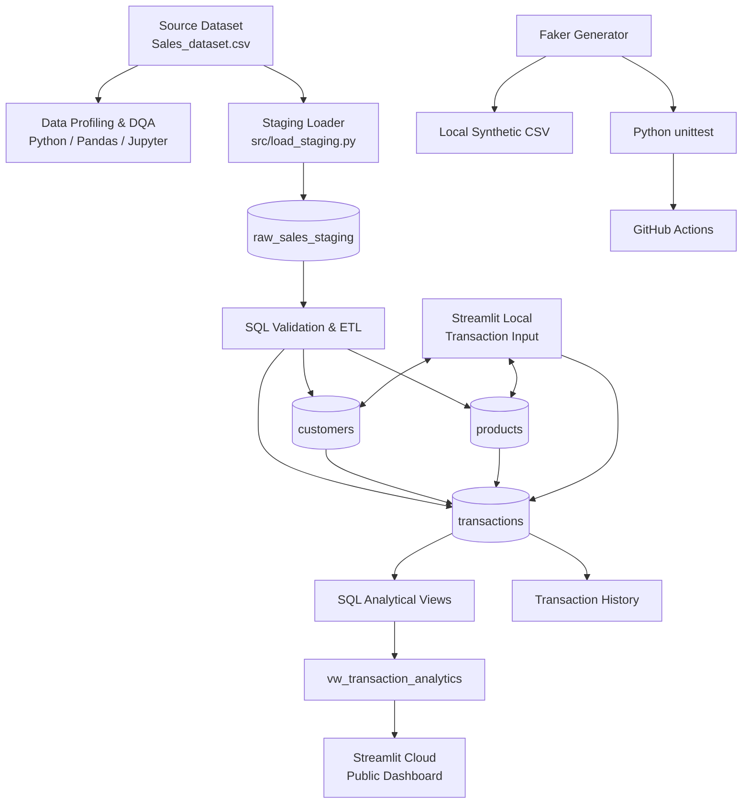

# System Architecture

## End-to-End Sales Data Management & Analytics System

| Document Information  | Details                       |
| --------------------- | ----------------------------- |
| Document Version      | 1.0                           |
| Last Updated          | 21 November 2026              |
| Architecture Type     | Data Management and Analytics |
| Database              | PostgreSQL (Supabase)         |
| Application Framework | Streamlit                     |

---

## 1. Architecture Overview

The project implements an end-to-end sales data management and analytics workflow.

The system covers:

1. Source data ingestion.
2. Data profiling and quality assessment.
3. Raw data staging.
4. ETL validation and transformation.
5. Relational database storage.
6. SQL-based analytical processing.
7. Transaction management.
8. Interactive analytics dashboard.
9. Synthetic data generation and automated testing.

The architecture separates production transaction processing from public dashboard access and synthetic test data generation.

## 2. High-Level System Architecture

The diagram separates the production data workflow from the synthetic data testing workflow.

## 3. Source Data and Profiling Layer

### Source Dataset

The original source file is:

`data/raw/Sales_dataset.csv`

Characteristics:

- CSV format with semicolon delimiter.
- 2,824 imported source rows.
- 2,823 transaction records after excluding one summary row.
- 18 usable source fields.
- Transaction period from January 4, 2023, to December 1, 2025.

The source dataset is retained locally and excluded from Git version control.

### Data Profiling

The notebook:

`notebooks/01_data_profiling.ipynb`

is used for:

- Dataset structure inspection.
- Missing value assessment.
- Duplicate detection.
- Numeric conversion.
- Date validation.
- Customer and product consistency checks.
- Business rule validation.
- Source-to-transaction reconciliation.

The original dataset is preserved, while data preparation is performed on a working copy.

## 4. Data Ingestion and ETL Layer

### 4.1. Raw Data Loading

The loading script is:

`src/load_staging.py`

It reads the source CSV and imports records into:

`public.raw_sales_staging`

The staging process preserves imported values as text before validation and transformation.

Each import uses an import batch identifier to maintain traceability.

### 4.2. ETL Processing

SQL scripts in `sql/` are used to:

1. Validate staging records.
2. Load normalized customer records.
3. Load normalized product records.
4. Load transaction records.
5. Verify database records.
6. Reconcile imported transaction data.
7. Create analytical SQL views.

### 4.3. Normalized Database Layer

The database uses four main tables:

| Table               | Responsibility                       |
| ------------------- | ------------------------------------ |
| `raw_sales_staging` | Stores raw imported records          |
| `customers`         | Stores customer master data          |
| `products`          | Stores product catalog data          |
| `transactions`      | Stores individual sales transactions |

The normalized transaction table references customer and product records through foreign keys.

Database constraints enforce quantity, pricing, status, and deal-size rules.

Detailed table definitions and relationships are documented in `data_dictionary.md` and `erd.md`.

## 5. Application Layer

The project uses Streamlit for transaction management and business analytics.

### 5.1. Local Transaction Management Application

Entry point:

`app/streamlit_app.py`

The local application supports transaction input.

Main responsibilities:

- Retrieve existing customers and products.
- Accept transaction date, quantity, selling price, and deal size.
- Generate a unique transaction reference.
- Calculate estimated sales and profit/loss.
- Display a calculation preview.
- Require user confirmation.
- Validate input before saving.
- Insert valid transactions into PostgreSQL.

The application uses database write access for transaction insertion.

### 5.2. Transaction History

File:

`app/pages/1_Transaction_History.py`

This page retrieves stored transaction records and supports:

- Transaction ID and transaction reference searches.
- Customer and product searches.
- Profit/Loss status filters.
- Deal size filters.
- Transaction detail review.

### 5.3. Analytics Dashboard

File:

`app/pages/2_Analytics_Dashboard.py`

The dashboard provides analytics views for:

- Executive KPIs.
- Monthly sales performance.
- Product performance.
- Customer performance.
- Geographic sales performance.
- Deal size performance.
- Transaction history.

The dashboard supports filtering and manual refresh.

## 6. Public Dashboard and Database Access

### Public Dashboard Entry Point

File:

`public_dashboard.py`

This file acts as a lightweight entry point that executes the dashboard page:

`app/pages/2_Analytics_Dashboard.py`

The public dashboard is deployed separately from the local transaction management application.

### Database Access Separation

The dashboard supports two connection modes through `APP_MODE`.

| Mode   | Configuration                                            | Purpose                                             |
| ------ | -------------------------------------------------------- | --------------------------------------------------- |
| Local  | `DB_HOST`, `DB_USER`, `DB_PASSWORD`                      | Local transaction management and application access |
| Public | `DB_READER_HOST`, `DB_READER_USER`, `DB_READER_PASSWORD` | Public dashboard database access                    |

In public mode, the dashboard reads from:

`public.vw_transaction_analytics`

The public dashboard uses a dedicated read-only database role rather than direct transaction write access.

This separation reduces the risk of exposing transaction write permissions to the public dashboard.

### Dashboard Refresh

Dashboard query results are cached for up to 300 seconds.

Users can manually refresh the dashboard to retrieve the latest available data.

## 7. Analytical Processing Layer

SQL analytical views support reporting and dashboard calculations.

The project includes analytical reporting for:

- Sales KPIs.
- Monthly sales trends.
- Product performance.
- Customer performance.
- Geographic sales.
- Deal size performance.

The public dashboard retrieves transaction analytics through `vw_transaction_analytics`.

This separates data retrieval and database logic from dashboard presentation.

## 8. Synthetic Data and Automated Testing

Synthetic data generation is maintained separately from the production transaction workflow.

### 8.1. Synthetic Data Generation

Script:

`src/generate_synthetic_data.py`

The generator uses Faker and Python randomization to create:

- Synthetic customer records.
- Synthetic product reference data.
- Synthetic sales transactions.
- Financial calculations based on project business assumptions.

Generated output:

`data/synthetic/synthetic_transactions.csv`

The generated CSV is stored locally and excluded from Git version control.

Synthetic records are not automatically inserted into the production Supabase database.

### 8.2. Automated Testing

Test file:

`tests/test_synthetic_data.py`

The project uses Python's built-in `unittest` framework.

The test suite contains 13 test cases covering:

- Transaction count and column structure.
- Missing values.
- Unique transaction references.
- Customer reference consistency.
- Product reference consistency.
- Numeric business rules.
- Financial calculations.
- Status and deal size validation.
- Order date range.
- Reproducible generation.
- CSV export.
- Invalid generator parameters.

### 8.3. Continuous Integration

Workflow:

`.github/workflows/synthetic-data-tests.yml`

GitHub Actions automatically executes the automated tests on:

- Push events to `main`.
- Pull requests targeting `main`.
- Manual workflow dispatch.

The workflow installs dependencies from `requirements.txt`, uses Python 3.11, and runs the unittest suite.

The workflow does not require production Supabase credentials.

The latest verified workflow completed with all 13 tests passing.

## 9. Security and Data Separation

The project applies the following security practices:

1. Environment variables are stored locally in `.env`.
2. Database credentials are excluded from Git version control.
3. Public dashboard access uses a separate database reader configuration.
4. The public dashboard does not require transaction write access.
5. Synthetic datasets are stored separately from source data.
6. GitHub Actions executes synthetic data tests without connecting to production Supabase.
7. The raw source dataset is excluded from the public repository.

These measures help separate development, public reporting, and automated testing responsibilities.

## 10. Data Assumptions and Limitations

### Estimated Cost

Estimated cost is calculated using 50% of MSRP.

This is a dataset assumption and does not represent verified procurement or operating cost.

### Currency

The original dataset does not explicitly specify its currency.

Dashboard values use USD ($) formatting for presentation purposes only. No currency conversion has been performed.

### Deal Size

The categories `Small`, `Medium`, and `Large` are retained from the source.

Their underlying quantity thresholds have not been independently established.

### Historical Transaction Timestamp

The `created_at` column was added after the original transaction load.

Historical records may contain NULL values in this column.

## 11. Related Documentation

| Document                 | Description                                        |
| ------------------------ | -------------------------------------------------- |
| `README.md`              | Project overview and setup guide                   |
| `data_dictionary.md`     | Source fields, database tables, and business rules |
| `data_quality_report.md` | Data profiling and quality assessment results      |
| `erd.md`                 | Entity relationships and database constraints      |
| `testing.md`             | Manual and automated testing documentation         |
