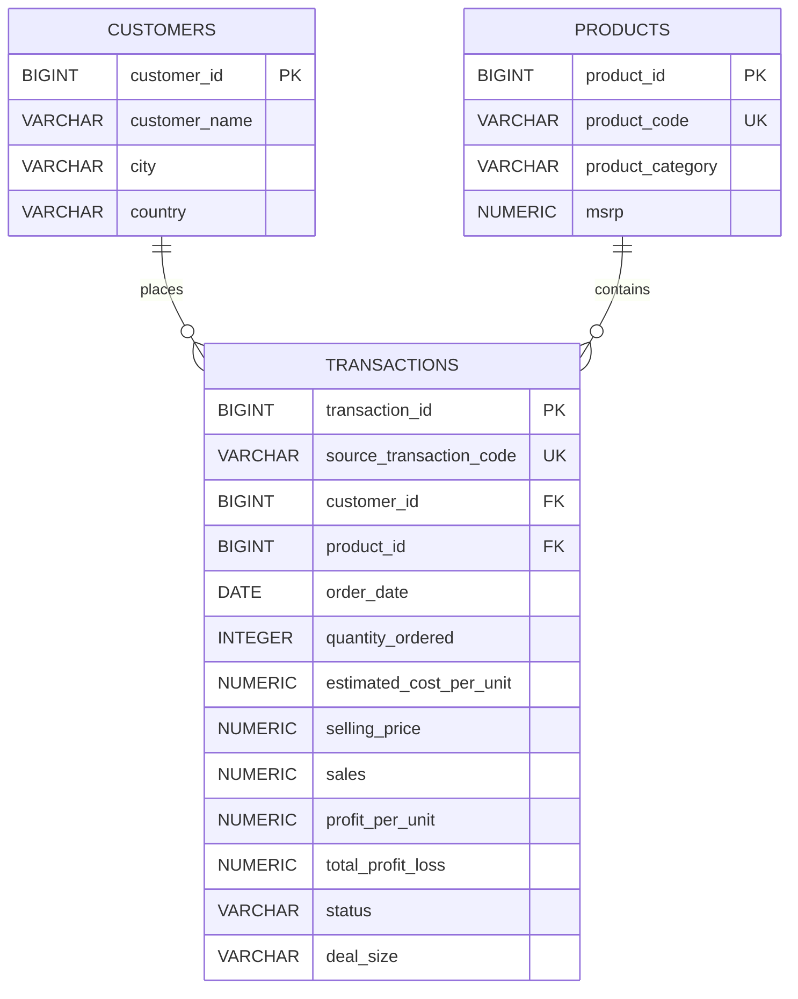

# Entity Relationship Diagram (ERD)

## Sales Data Management & Analytics System

**Version:** 1.0  
**Status:** Proposed Database Design

## 1. Overview

The relational database consists of three primary entities:

- `customers`: stores customer master data.
- `products`: stores product master data.
- `transactions`: stores historical sales transaction records.

The model uses surrogate primary keys for internal identification and foreign keys to maintain referential integrity.

## 2. Entity Relationship Diagram

## 3. Relationships

| Parent Entity | Child Entity | Cardinality | Description                                     |
| ------------- | ------------ | ----------- | ----------------------------------------------- |
| customers     | transactions | 1:N         | One customer can have multiple transactions     |
| products      | transactions | 1:N         | One product can appear in multiple transactions |

Each transaction must reference exactly one customer and one product.

## 4. Primary Keys and Foreign Keys

| Table        | Key    | Column                  | Purpose                          |
| ------------ | ------ | ----------------------- | -------------------------------- |
| customers    | PK     | customer_id             | Internal customer identifier     |
| products     | PK     | product_id              | Internal product identifier      |
| products     | UNIQUE | product_code            | Source product identifier        |
| transactions | PK     | transaction_id          | Internal transaction identifier  |
| transactions | UNIQUE | source_transaction_code | Original source code             |
| transactions | FK     | customer_id             | References customers.customer_id |
| transactions | FK     | product_id              | References products.product_id   |

## 5. Design Decisions

1. Surrogate primary keys are used for all three entities.
2. `CUSTOMER_CODE` is retained as `source_transaction_code` because it is unique per row, but its original business meaning has not been confirmed.
3. `CUSTOMER_NAME` is not used as a primary key.
4. `PRODUCT_CODE` is retained as a unique business identifier.
5. Historical estimated cost and profit values are stored in transactions to preserve transaction-level snapshots.
6. `MONTH` and `YEAR` are excluded from the transaction table because they can be derived from `order_date`.
7. `PRODUCT` is interpreted as product category based on its seven distinct values.

## 6. Known Limitations

- The original business meaning of `CUSTOMER_CODE` requires confirmation.
- Customer names are unique in the current dataset but are not assumed to be globally unique.
- Estimated cost is based on 50% of MSRP, not actual procurement cost.
- Currency has not yet been independently confirmed.

## 7. Next Step

Implement the proposed relational schema in PostgreSQL and validate primary keys, foreign keys, unique constraints, and check constraints.
