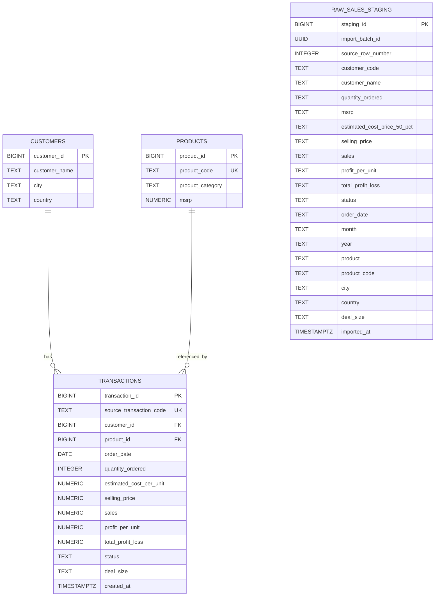

# Entity Relationship Diagram (ERD)

## Sales Data Management & Analytics System

| Document Information  | Details                  |
| --------------------- | ------------------------ |
| Version               | 1.1                      |
| Last Updated          | 21 November 2026         |
| Implementation Status | Implemented and Verified |
| Database              | PostgreSQL (Supabase)    |

---

## 1. Overview

The database implementation consists of four tables:

1. `raw_sales_staging`: stores imported source records in their original text representation before ETL processing.
2. `customers`: stores normalized customer master data.
3. `products`: stores normalized product catalog information.
4. `transactions`: stores transaction-level sales information and references customer and product records.

The normalized relational model uses surrogate primary keys, foreign keys, unique constraints, and check constraints to maintain data integrity.

The staging table serves as the raw ingestion layer and is intentionally separate from the normalized relational relationships.

## 2. Entity Relationship Diagram

## 3. Entity Descriptions

### 3.1. `raw_sales_staging`

**Purpose:** Temporary raw landing table for imported source records before validation and transformation.

Key characteristics:

- Uses TEXT for raw source values to preserve their original representation.
- Uses `staging_id` as its primary key.
- Uses `import_batch_id` to identify import batches.
- Uses `source_row_number` to retain source row references.
- Uses `imported_at` to record when records are imported.
- Enforces uniqueness on (`import_batch_id`, `source_row_number`).

This table is not directly connected to the normalized customer, product, and transaction relationships through foreign keys.

### 3.2. `customers`

**Purpose:** Stores normalized customer master records.

| Column          | Data Type | Key / Constraint      |
| --------------- | --------- | --------------------- |
| `customer_id`   | BIGINT    | Primary Key, Identity |
| `customer_name` | TEXT      | NOT NULL              |
| `city`          | TEXT      | NOT NULL              |
| `country`       | TEXT      | NOT NULL              |

**Unique constraint:**

`uq_customer_identity`

UNIQUE (`customer_name`, `city`, `country`)

Customer records are resolved using the combination of customer name, city, and country.

### 3.3. `products`

**Purpose:** Stores the product catalog.

| Column             | Data Type     | Key / Constraint              |
| ------------------ | ------------- | ----------------------------- |
| `product_id`       | BIGINT        | Primary Key, Identity         |
| `product_code`     | TEXT          | NOT NULL, UNIQUE              |
| `product_category` | TEXT          | NOT NULL                      |
| `msrp`             | NUMERIC(12,2) | NOT NULL, CHECK (`msrp >= 0`) |

Product records are identified by their unique product codes.

### 3.4. `transactions`

**Purpose:** Stores individual sales transaction records and links customer and product master data.

| Column                    | Data Type     | Key / Constraint                                 |
| ------------------------- | ------------- | ------------------------------------------------ |
| `transaction_id`          | BIGINT        | Primary Key, Identity                            |
| `source_transaction_code` | TEXT          | NOT NULL, UNIQUE                                 |
| `customer_id`             | BIGINT        | NOT NULL, Foreign Key                            |
| `product_id`              | BIGINT        | NOT NULL, Foreign Key                            |
| `order_date`              | DATE          | NOT NULL                                         |
| `quantity_ordered`        | INTEGER       | NOT NULL, CHECK (`quantity_ordered > 0`)         |
| `estimated_cost_per_unit` | NUMERIC(12,2) | NOT NULL, CHECK (`estimated_cost_per_unit >= 0`) |
| `selling_price`           | NUMERIC(12,2) | NOT NULL, CHECK (`selling_price > 0`)            |
| `sales`                   | NUMERIC(14,2) | NOT NULL, CHECK (`sales >= 0`)                   |
| `profit_per_unit`         | NUMERIC(12,2) | NOT NULL                                         |
| `total_profit_loss`       | NUMERIC(14,2) | NOT NULL                                         |
| `status`                  | TEXT          | NOT NULL, Profit or Loss                         |
| `deal_size`               | TEXT          | NOT NULL, Small, Medium, or Large                |
| `created_at`              | TIMESTAMPTZ   | Nullable, DEFAULT NOW() for future inserts       |

**Foreign keys:**

- `fk_transaction_customer`: references `customers.customer_id`.
- `fk_transaction_product`: references `products.product_id`.

**Additional timestamp information:**

The `created_at` column was added through a database migration. It defaults to `NOW()` for new records. Existing historical records may retain NULL values because the column was added after the original transaction load.

## 4. Entity Relationships

| Parent Table | Child Table    | Cardinality       | Explanation                                     |
| ------------ | -------------- | ----------------- | ----------------------------------------------- |
| `customers`  | `transactions` | One-to-Many (1:N) | One customer can have multiple transactions     |
| `products`   | `transactions` | One-to-Many (1:N) | One product can appear in multiple transactions |

Each transaction must reference exactly one customer and one product.

A customer or product can exist without an associated transaction.

`raw_sales_staging` is maintained separately as the ETL ingestion layer and is not directly linked to the normalized entities by foreign keys.

## 5. Primary Keys, Foreign Keys, and Unique Constraints

| Table               | Constraint  | Column(s)                              | Purpose                                                |
| ------------------- | ----------- | -------------------------------------- | ------------------------------------------------------ |
| `raw_sales_staging` | PRIMARY KEY | `staging_id`                           | Unique staging record identifier                       |
| `raw_sales_staging` | UNIQUE      | `import_batch_id`, `source_row_number` | Prevent duplicate source row references within a batch |
| `customers`         | PRIMARY KEY | `customer_id`                          | Internal customer identifier                           |
| `customers`         | UNIQUE      | `customer_name`, `city`, `country`     | Enforce customer identity                              |
| `products`          | PRIMARY KEY | `product_id`                           | Internal product identifier                            |
| `products`          | UNIQUE      | `product_code`                         | Unique product identifier                              |
| `transactions`      | PRIMARY KEY | `transaction_id`                       | Internal transaction identifier                        |
| `transactions`      | UNIQUE      | `source_transaction_code`              | Unique source transaction reference                    |
| `transactions`      | FOREIGN KEY | `customer_id`                          | References `customers.customer_id`                     |
| `transactions`      | FOREIGN KEY | `product_id`                           | References `products.product_id`                       |

## 6. Check Constraints and Business Rules

The `transactions` table enforces the following rules:

| Constraint                  | Business Rule                                   |
| --------------------------- | ----------------------------------------------- |
| `chk_transaction_quantity`  | Quantity ordered must be greater than zero      |
| `chk_estimated_cost`        | Estimated cost per unit must be non-negative    |
| `chk_selling_price`         | Selling price must be greater than zero         |
| `chk_sales`                 | Sales must be non-negative                      |
| `chk_transaction_status`    | Status must be `Profit` or `Loss`               |
| `chk_transaction_deal_size` | Deal size must be `Small`, `Medium`, or `Large` |

The `products` table also enforces:

- `chk_product_msrp`: MSRP must be non-negative.

The database constraints are aligned with the application's input validation rules.

## 7. Design Decisions

1. Surrogate primary keys are used for customers, products, and transactions.
2. `CUSTOMER_CODE` from the source dataset is mapped to `transactions.source_transaction_code`. Its original business meaning has not been independently confirmed.
3. `CUSTOMER_NAME` is not used as a primary key.
4. Customer identity is determined by the combination of name, city, and country.
5. `PRODUCT_CODE` is retained as the unique product business identifier.
6. Historical estimated cost and profit values are stored in transactions to preserve transaction-level financial snapshots.
7. `MONTH` and `YEAR` are excluded from the normalized transaction table because they can be derived from `order_date`.
8. `PRODUCT` is interpreted as product category based on its seven distinct values.
9. `raw_sales_staging` is kept separate from the normalized entities to preserve the raw ingestion and validation stage.
10. `created_at` records the database insertion timestamp for newly inserted transactions.

## 8. Indexes

The database includes indexes to support transaction lookups and monitoring:

| Index                         | Table        | Indexed Column(s)                                    |
| ----------------------------- | ------------ | ---------------------------------------------------- |
| `idx_transactions_customer`   | transactions | `customer_id`                                        |
| `idx_transactions_product`    | transactions | `product_id`                                         |
| `idx_transactions_order_date` | transactions | `order_date`                                         |
| `idx_transactions_created_at` | transactions | `created_at DESC`, partial index for non-NULL values |

Primary key and unique constraints also create their corresponding supporting indexes.

## 9. Known Limitations and Assumptions

- The original business meaning of `CUSTOMER_CODE` has not been independently confirmed.
- Customer names are not assumed to be globally unique; identity is based on name, city, and country.
- Estimated cost is based on 50% of MSRP, not actual procurement cost.
- The source currency has not been independently confirmed.
- Historical transactions may contain NULL `created_at` values.
- The source deal-size categories are retained without independently establishing their quantity thresholds.

## 10. Implementation Status

**Status: Implemented and verified.**

The normalized schema, staging table, primary keys, foreign keys, unique constraints, check constraints, and supporting indexes have been created in PostgreSQL.

Database structure and constraints were inspected, and transaction input was tested through the local Streamlit application.

A successful transaction was inserted into Supabase and subsequently verified in Transaction History and the deployed analytics dashboard.
